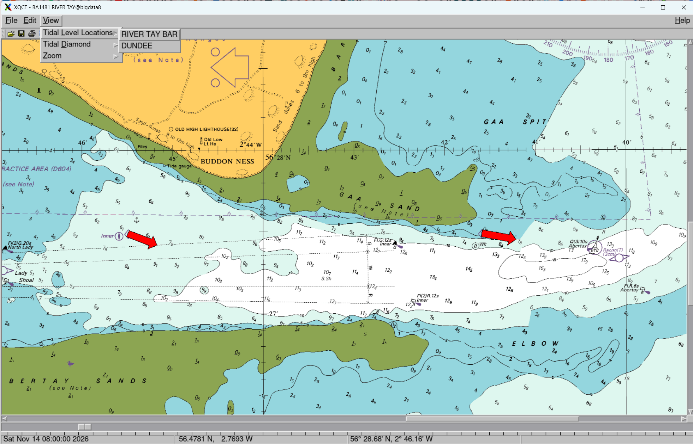

# xqctide - marine chart viewer and tidal stream plotter

This program displays marine charts in QCT format and overlays the tidal streams as arrows whose size indicates the water speed. There is a date/time slider to display tidal streams throughout the day so you can find slack water for diving. Warning: the tide information is based on freely available harmonics and is not guaranteed. The charts are also not certified for navigation.

As you drag the date/time slider you will see the arrows rotate and grow longer/shorter.
The length indicates the rate of flow. Slack water (e.g. near low tide or high tide) are when the arrow is shortest.
The arrow points in the direction of flow, e.g. towards the coast for a rising tide.

The program was originally written with Qt version 3.

## Screenshot



## Running

```
sudo apt install libtcd-dev xtide
ln -sf /usr/bin/tide ./tide
export HFILE_PATH=$(pwd)/harmonics-dwf-20091227-nonfree.tcd
bunzip2 BA1481_1.qct.bz2
```

xtide and libtcd are hosted at https://flaterco.com/xtide/
in particular https://flaterco.com/xtide/files.html

Other tcd files can be downloaded from https://github.com/openwatersio/slackwater-database/tree/main/packages/tcd
in particular https://github.com/openwatersio/slackwater-database/releases


## Building


You will need satlib, and qt3 ready built in /opt/DSSingest
```
export SWDEV=~/src/dss/src
export SWDEVARCH=LINUX
export SWDEVLOCAL=/opt/DSSingest
export QTDIR=$SWDEVLOCAL/qt3
export QMAKESPEC=${QTDIR}/mkspecs/linux-g++
export PATH=${PATH}:${QTDIR}/bin:${SWDEVLOCAL}/bin
qmake3 -o Makefile.${SWDEVARCH} xqct.pro
# Maybe edit Makefile.LINUX to add -fpermissive` and perhaps `-std=gnu99`
make -f Makefile.${SWDEVARCH}
```

## Debugging

`export DEBUG=`

